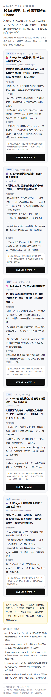

# AI 项目雷达 · 每 3 天给你手机发一期「GitHub 上有点疯的 AI 项目」

一句话：**自动去 GitHub 捞最近在涨星、还没烂大街的 AI 项目，写成一篇能在地铁上刷完的图文，发到你手机上。**
跑在 GitHub 的服务器上 → **不用开电脑，不用开梯子**；每 3 天的早上 7:30 到。

第 1 期长这样（390px 手机宽度，微信里点开就是这个）：



---

## 内容比"只有标题"强在哪

| | 那种「热点标题机器人」 | 这个 |
|---|---|---|
| 内容 | 一行标题 + 链接 | 每个项目 4 段：这是啥（人话）→ 为啥值得看 → 上手难在哪 → 可以先怎么玩 |
| 筛选 | 关键词/热榜 | 涨星速度 + 新鲜度 + 关键词加分，砍掉 awesome/教程/面试八股/擦边 |
| 排版 | 纯文本 | 手机宽度的卡片图文，微信里点开就是一张长图 |
| 重复 | 容易发重 | 记着「推过哪些仓库」，同一个项目不会再出现在下期 |

两个版本共用一套渲染和推送：

- **精读版**：我（AI）手写，有人话翻译、有梗、有"我建议你先试哪个"。你开着电脑时叫一声就出。
- **速报版**：脚本按规则拼，**项目描述用作者原文，不瞎翻译不瞎编**。电脑没人管时自动发，任务是"不漏"。

---

## 发送通道：微信 pushplus（已实名，主通道）

| 通道 | 状态 | 说明 |
|---|---|---|
| **微信 pushplus** | ✅ **正在用**（已实名，实测 code 200） | 消息进微信「pushplus 推送加」公众号，点开就是图文卡片 |
| 邮箱 SMTP | 备用（代码已支持） | 哪天想把推送落到邮箱，填 5 个 MAIL_* 就能切 |
| Server酱³ / 企微机器人 | 备用（代码已支持） | 需要 key / webhook，几分钟接上 |

> 提醒：PushPlus 从 2024-08 起要求实名（姓名+身份证+手机号+短信码，且要付第三方认证费或买会员），
> 未实名发消息会返回 `905`。已经实名过的账号直接填 token 就能用。

---

## 三步跑起来（其实已经配好了，这几步是换机/重装时用的）

### 1. 拿 token

微信搜公众号「**pushplus 推送加**」→ 关注 → 菜单进「我的」/个人中心 → 复制 **token**。

### 2. 填进 `channels.json`

```json
{
  "channel": "pushplus",
  "pushplus_token": "你的token"
}
```

### 3. 测一发

```powershell
python push.py --test        # 微信收到「通道测试」就通了
python run.ps1 -Force        # 立刻发一期
```

---

## 放到云端（电脑关机也照发）

仓库里已带好 `.github/workflows/digest.yml`，也可以用我打好的 `ai-digest-cloud.zip`。步骤：

1. GitHub → New repository → **Private**（私有库，别人看不到）
2. 把 zip 里的文件传上去（网页版 "uploading an existing file" 拖拽即可）
3. Settings → Secrets and variables → Actions → 新建 **1 个** Secret：

   | Name | 值 |
   |---|---|
   | `PUSHPLUS_TOKEN` | 你的 pushplus token |

4. Actions 标签 → 允许 workflows → 点 **AI 项目雷达** → Run workflow（第一次手动跑，验证通道）
5. 之后它每天 **北京 07:30** 检查一次，距上一期满 3 天才发（`due.py` 拦重复），某天失败第二天自动补

> 工作流里只有一个入口：`python cloud_digest.py`（抓 → 组 → 渲 → 发，四步串好）。
> 想手动重跑一次：`python cloud_digest.py --force`；只想看成品不发：`--dry`。
> 想改用邮箱：再建 `MAIL_HOST/PORT/USER/PASS/TO` 五个 Secret，把 `PUSHPLUS_TOKEN` 删掉即可（push.py 会自动选通道）。

> 两个坑我已经绕开了：
> ① `.github/workflows/` 这种点开头目录在网页上传时容易丢，如果 Actions 页签一直是空的，就用 "Add file → Create new file"，文件名直接输 `.github/workflows/digest.yml`，把内容粘进去。
> ② GitHub 规矩：仓库 60 天没动静会自动停掉定时任务 —— 所以工作流每次都把 `state.json` 提交回去，保持活跃。

---

## 本机这条线（目前已卸载，只在云端跑）

- 计划任务「AI项目雷达」和登录启动项**已经撤掉**，避免和云端各发一次
- 想恢复本机兜底：`.\setup_task.ps1`（装回来），`.\setup_task.ps1 -Remove`（再撤掉）
- 临时手动补一期：先去 Actions 里点 Run workflow；本机 `run.ps1 -Force` 只在云端挂了时用
- 日志都在 `logs\`

---

## 改口味（都在文件里，不用改代码）

| 想要 | 改哪里 |
|---|---|
| 只推某一类（不碰硬件 / 只推能白嫖的） | `config.json` → `queries`（搜索词）、`block`（拉黑词）、`bonus`（加分词） |
| 星数门槛 / 时间窗 / 每期几个 | `config.json` → `min_stars` / `max_age_days` / `top_n`；脚本参数 `--n` |
| 3 天 → 5 天 | `due.py` 和 `run.ps1` 里的 `2.5`；以及云端 `digest.yml` 的 cron |
| 晚上 8 点 → 早上 7 点 | 云端：改 cron（UTC = 北京-8）；本机：`schtasks /Change /TN "AI项目雷达" /ST 07:30` |
| 文案风格 | 直接跟我说，我重写 `issue.json` 再发一期 |
| 多塞几个"顺手扫到的" | `issue.json` 的 `bonus` 数组 |

---

## 排错

| 现象 | 处理 |
|---|---|
| 日志 `GitHub API 完全不通` | 梯子/网络问题。本机会自动试镜像代理，都不通就安静跳过（宁可漏发也不发垃圾） |
| `HTTP 403` 刷屏 | 未登录搜索接口 10 次/分钟限速。脚本已按 6 秒/次 + 遇 403 等 30 秒重试 |
| 邮件没到 | ① 授权码是否过期 ② 看垃圾箱 ③ `python push.py --test` 看报错（`535` = 授权码错，`Connection closed` = 端口被封，换 587） |
| 微信没收到 | ① 公众号「pushplus 推送加」里点进消息列表看看 ② `python push.py --test` 看返回码：`200` = 服务端已受理，`905` = 账号实名掉了，`903` = token 错 |
| 云端 Actions 没跑 | Actions 页签 → 确认 workfows 已允许；再看 Runs 里的报错 |
| 说"距上期 X 天，跳过" | 正常。想硬发：`run.ps1 -Force` |

---

## 费用与隐私

- **全免费**：GitHub 公开 API + 自己邮箱 SMTP + 本机 Python 标准库。私有库 Actions 每月 2000 分钟免费额度，这套每期只用 1 分钟左右。
- 只调 GitHub 公开搜索接口和你的邮箱 SMTP；不读你的仓库。
- `channels.json`、GitHub Secrets 里是密钥，别贴群里、别提交进仓库（`.gitignore` 已拦）。

---

## 文件清单

```
ai-digest/
├─ run.ps1               本机一键跑（周期判断 + 抓 + 组 + 渲 + 推 + 日志）
├─ go.cmd                双击入口（绕过 PowerShell 执行策略）
├─ setup_task.ps1        装/卸 计划任务 + 登录启动项
├─ cloud_digest.py       云端一个入口：抓 → 组 → 渲 → 发
├─ due.py                云端用：现在该不该发
├─ config.json           搜索词、门槛、拉黑词、加分词
├─ fetch_repos.py        ① 抓
├─ build_auto_issue.py   ② 写（速报版）
├─ issue.json            ② 写（精读版，手写）
├─ render_issue.py       ③ 渲（HTML/MD/TXT）
├─ push.py               ③ 推（mail / pushplus / serverchan / webhook）
├─ channels.json         ← 你的密钥（自己建，别外传）
├─ state.json            记账：第几期、推过哪些仓库、上次发送时间
├─ build/                成品：issue-N.html / .md / .txt / 预览图
├─ logs/                 运行日志
└─ .github/workflows/digest.yml   云端每天检查、满 3 天发（北京 07:30）
```
